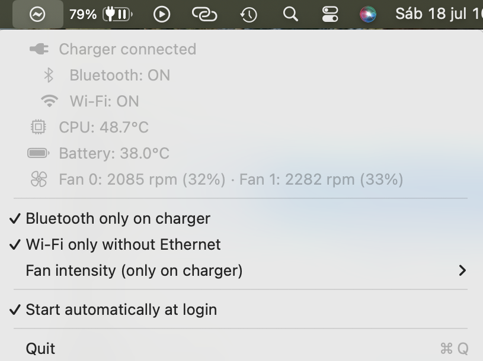

# PlugPilot

A macOS menu-bar app that automates radios and fans based on power source, on
generic Intel Macs. *(Lea esto en [español](README.es.md).)*

<!-- TODO: add a screenshot of the open menu here, e.g.  -->

## What it does

PlugPilot adds a menu-bar item with an informational panel (power source,
Bluetooth, Wi-Fi/Ethernet status, CPU and battery temperature, fan RPM) and
three **independent** automations, all **off by default**:

- **Bluetooth only on charger** — turns Bluetooth on when the charger is
  connected, off on battery.
- **Wi-Fi only without Ethernet** — turns Wi-Fi off whenever there is a real
  Ethernet link (cable/dock), regardless of power source; on in any other
  case. The Ethernet detection walks the IORegistry to tell a physical link
  apart from virtual ones (Bluetooth PAN, iPhone/iPad USB tethering), so it
  works regardless of the system language.
- **Fan intensity (only on charger)** — a single submenu with five options
  (Default/Soft/Medium/Strong/Extreme); "Default" leaves fans on the SMC's
  automatic control, the other four force RPM while on the charger to that
  intensity (25/33/50/75% of each fan's SMC-reported maximum, never below
  its factory minimum). Switches back to automatic on battery or when
  "Default" is selected.

Turning the Bluetooth or Wi-Fi toggle on applies its policy immediately with
the current state; turning it off does **not** restore anything — they stay
as they are, since the user is in control. Fan intensity works the same idea
in reverse: picking an intensity other than "Default" applies it
immediately, and picking "Default" always hands control back to the SMC's
automatic mode.

Every automation degrades gracefully: on machines without fans, a battery,
or Wi-Fi hardware, the corresponding menu items are hidden automatically
(capabilities are detected once at launch).

## Requirements

- macOS 13 (Ventura) or later.
- **Generic Intel Mac.** All hardware-dependent behavior (fan count, RPM
  ranges, temperature sensor keys) is detected at runtime through the Apple
  SMC, so PlugPilot should work across Intel Mac models without
  per-machine tuning.
- **Apple Silicon is not supported.** The fan-control path in this app talks
  to the Intel-era AppleSMC user client protocol (`F#Md`/`F#Tg`/`F#Mn`/`F#Mx`
  keys) that Apple Silicon Macs don't expose the same way. Supporting M-series
  Macs would need a different, unverified low-level approach, which is out of
  scope for this project.

## Installation (from a release)

1. Download the latest `PlugPilot-<version>.zip` from the
   [Releases](../../releases) page and unzip it.
2. Move `PlugPilot.app` to `/Applications` (or anywhere you like).
3. Releases are **not notarized** by Apple, so Gatekeeper will refuse to open
   it with a plain double-click. Instead: **right-click (or Control-click)
   the app → Open**, then confirm in the dialog that appears. You only need
   to do this once.
4. If you pick a **"Fan intensity (only on charger)"** option other than
   "Default", PlugPilot registers a small privileged helper
   (`PlugPilotHelper`) that talks to the SMC. macOS will ask you to approve
   it under **System Settings → General → Login Items** (look for PlugPilot
   under "Allow in the Background" / helper section). Approve it there for
   fan control to take effect.

## Building from source

```bash
./build.sh        # swift build -c release + assembles PlugPilot.app + ad-hoc codesign
open PlugPilot.app
```

Never use a bare `swift build` as your final step — it doesn't update the
`.app` bundle at the repo root, which is what you actually run. There is no
automated test suite; verification is manual.

To produce a distributable zip (mirrors what `./build.sh` does, then zips
the bundle using the version from `Info.plist`):

```bash
./release.sh
```

## Security

PlugPilot writes to `AppleSMC`-managed hardware registers, and macOS only
allows such writes from a **root** process. That's the entire reason
`PlugPilotHelper` exists: a minimal privileged daemon, installed via
`SMAppService.daemon` and talked to over XPC, whose *only* job is applying
fan mode/target requests.

Points worth knowing if you're deciding whether to trust it:

- **Minimal surface.** The helper accepts exactly one kind of request: set a
  given fan's mode and target RPM (plus a no-op ping). It does not execute
  arbitrary commands, read files, or expose any other capability.
- **RPM is always clamped.** Before writing, the helper reads that fan's
  factory minimum (`F#Mn`) and maximum (`F#Mx`) directly from the SMC on
  every request, and clamps the target between them. If either key can't be
  read, it writes nothing and returns an error status — it never invents a
  minimum. Running a fan faster than its factory minimum is safe; slower
  is the thing being guarded against.
- **Thermal valve.** Forced RPM is only applied while `ProcessInfo`'s
  thermal state is `.nominal`. If thermal pressure increases, control is
  handed back to the SMC automatically.
- **Idle exit.** The helper process exits after 20 seconds of inactivity; it
  isn't a persistent resident process beyond that.
- **Known limitation: ad-hoc signing and rebuilds.** The daemon-approval
  mechanism (Launch Constraint Requirements) pins a code requirement to the
  *hash* of the helper binary. Because releases are signed ad-hoc (not with
  a paid Developer ID), every time you rebuild from source the helper's hash
  changes and the previous approval becomes invalid — `launchd` will report
  "spawn failed" and fan requests will silently queue forever. If this
  happens: reopen the app (it re-registers automatically) and, if that's not
  enough, re-approve it under
  **System Settings → General → Login Items**. This is expected behavior
  given ad-hoc signing, not a bug to chase.

If you don't need fan control, simply leave the intensity submenu on
"Default" — PlugPilot never registers or launches the helper unless you
pick a different option.

## License

GPL-3.0. See [LICENSE](LICENSE).
